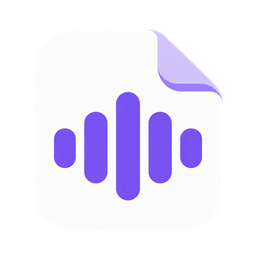

# HiDockNotes

Turn HiDock recordings and imported audio into searchable transcripts, meeting notes, and action items.

HiDockNotes is a private recording library you can host on your own server. Open it as a website or install the same interface as a PWA. Sync a HiDock directly from desktop Chrome or Edge, upload existing audio, and access your transcripts, meeting notes, tasks and Assistant from any device. Audio storage, CPU transcription and optional semantic search run on the server. ChatGPT plan and API connections can generate summaries and source-linked answers.

The desktop application remains available as a rollback option while physical browser/PWA USB validation is completed. The web build has no Electron runtime or native helper.

**[Download the latest release](https://github.com/Amitai5/HiDockNotes/releases/latest)** · [Release history](https://github.com/Amitai5/HiDockNotes/releases) · [Report an issue](https://github.com/Amitai5/HiDockNotes/issues)

## What it does

| Feature | What you can do |
| --- | --- |
| Recorder sync and audio import | Download recordings from a HiDock over USB, or import existing audio without a recorder. Downloads are checked for completeness and verified with SHA-256. |
| Searchable library | Organize recordings into project folders, add tags, and search titles, transcripts, and summaries. Filter by project, date, or processing status. |
| Local transcription | Transcribe with Whisper on your CPU, with timestamps and speaker labels. Choose Base for speed or Small for higher accuracy. |
| Meeting notes | Generate a title, meeting type, participants, tags, discussion summary, decisions, open questions, risks, and next steps. |
| Remembered voices | Name speakers, save clean voice samples locally, and manage people and samples from a compact list and detail panel. |
| Actionables | Track tasks with owners, due dates, completion history, and links back to their source moments. |
| Assistant | Ask questions across your library or within one project. Copy answers and review cited transcripts, notes, and audio in a right-hand panel while keeping the chat open. |
| Saved conversations | Create, rename, search, and reopen Assistant chats with their project scope and source citations. Complete backups include them. |
| Search by meaning | Optionally download a small local model to combine semantic matches with keyword search in Library and Assistant. |
| Calendar-linked meetings | Connect a Google Calendar private iCal feed and link matching events, agendas, and invitees to recordings. |
| Transcript corrections | Edit text, restore earlier versions, and compare a new transcription before replacing corrected work. |
| Export and recovery | Export notes, subtitles, and playable audio; back up and restore the complete library. |
| MCP access | Let an MCP-compatible agent search recordings by meaning and read notes, meeting outcomes, tasks, and saved reference context through a local, read-only connection. |

## Install on TrueNAS or another Docker server

Released images are published to **`ghcr.io/amitai5/hidocknotes:<version>`**. Download `compose.yaml` from a release, copy [.env.example](.env.example) to `.env`, and set your HTTPS website origin and persistent library/backup dataset paths.

```sh
docker compose pull
docker compose up -d
docker compose logs hidocknotes
```

Open the website and copy the **eight-character setup code from the container logs** to create your owner account. It uses letters and digits without confusing `0/O` or `1/I`. The code is shown only before owner setup. Your data persists in `/data`; complete backup archives go to `/backups`.

In Chrome or Edge, choose **Install** in the app header or browser menu for a standalone PWA window. Direct HiDock USB needs HTTPS and an open tab/PWA window. Other browsers can use the library and upload audio. The server needs no USB passthrough.

See the [self-hosting guide](docs/self-hosting.md) for dataset permissions, resource limits, ChatGPT sign-in through an SSH tunnel, desktop backup migration, restore, MCP, updates and the physical USB validation gate. Releases include a PWA archive, Compose configuration and the exact GHCR image digest alongside the platform installers.

## Desktop installers

Open [the latest GitHub release](https://github.com/Amitai5/HiDockNotes/releases/latest), expand **Assets**, and choose the installer for your computer. The installers bundle the application runtime and audio conversion tools.

| Your computer | File to download | Installation |
| --- | --- | --- |
| Windows x64 | `HiDockNotes-<version>-windows-x64-setup.exe` | Run the installer and choose the installation folder. Windows may request administrator approval when updating an installation in Program Files. |
| Mac with Apple Silicon | `HiDockNotes-<version>-macos-arm64.dmg` | Open the disk image and drag HiDockNotes into Applications. |
| Mac with an Intel processor | `HiDockNotes-<version>-macos-x64.dmg` | Open the disk image and drag HiDockNotes into Applications. |
| Linux x64, AppImage | `HiDockNotes-<version>-linux-x64.AppImage` | Allow the file to run as a program in its permissions, then open it. |
| Debian/Ubuntu x64 | `HiDockNotes-<version>-linux-x64.deb` | Install with your distribution's software installer or package manager. |

Each release includes `SHA256SUMS.txt` for checking the downloaded files. Current Windows releases are unsigned; Mac releases are ad-hoc signed without Apple notarization, so operating-system security prompts may appear.

HiDock P1 on Windows is the primary hardware target. CI builds and checks the packaged application on all four platform/architecture targets above; interactive Mac/Linux use and physical recorder operation on those platforms still need validation.

### Updating an existing installation

Check **Settings → About → Application updates** for the latest release and its notes. Current unsigned builds use manual installer downloads. Create a library backup, close HiDockNotes, and install the newer release over the existing application. Signed in-app installation is prepared for releases with configured signing credentials; see the [update guide](docs/backup-transcripts-updates.md#in-app-updates).

## First-time setup

1. **Choose transcription.** Open **Settings → AI & transcription**. Local Whisper is selected by default and needs no API key. The speech models download and are verified on first use; afterward, local transcription works offline. Base is faster; Small uses more processing time for higher accuracy.
2. **Connect summaries and Assistant.** Use **Continue with ChatGPT** with an eligible account and authorize plan usage, or enter a Gemini/OpenAI API key and choose **Verify & save**. Select the provider and model under **Chat & summaries**. Account eligibility and usage limits apply; API providers use their own billing. This selection is separate from audio transcription.
3. **Add recordings.** Connect a HiDock using a USB data cable and open **Sync**, or choose **Import audio** in **Library**. Supported imports are MP3, M4A, WAV, OGG, FLAC, and HDA.
4. **Process audio.** Leave **Auto-transcribe on download** enabled for new downloads. Use **Process saved recordings** for existing unprocessed local recordings. The app processes one recording at a time and shows the current stage and waiting queue in Library. Local transcription can finish before a summary provider is connected.
5. **Review the result.** Open the recording to read its notes, play the audio, correct transcript text, and name speakers. Settings also lets you choose a language and a Meeting, Call, Interview, Dictation, or Custom prompt summary template.

Cloud transcription is optional: choose Gemini or OpenAI under **Transcription** only if you want audio sent to that provider. ChatGPT account sign-in supports eligible text requests for summaries and Assistant, not audio transcription.

**Optional search setup:** After installation, Library offers **Download & enable** for a 24 MB English semantic-search model. Choose **Skip** to keep using keyword search. You can download, disable, or remove the model later in **Settings → AI & transcription → Search by meaning**. Nothing downloads until you enable it.

## Use your library

### Organize and find recordings

- Create project folders in Library. Opening a folder shows its own recordings; **Unfiled recordings** contains items without a project.
- Drag a recording onto a sidebar folder to file it, or onto Unfiled to remove its project assignment.
- Resize the sidebar and the recording workspace divider by dragging their edges. Folder names wrap to stay readable.
- Rename a recording from its title and manage tags from its overview. Manual titles and tags are preserved when generating new notes.
- Use the top search bar to search saved titles, transcripts, and summaries across folders. With local meaning search enabled, choose **Meaning + keywords** to find related passages even when your wording differs. Results show a matching passage and link to its timestamp.

### Read meeting notes and manage tasks

The recording overview shows its title, date, project, meeting type, participants, and tags. Generated notes start with a purpose-and-outcome summary, followed by key discussion points, decisions, open questions, risks/blockers, and next steps.

New summaries also save structured meeting outcomes: decisions, unresolved questions and expected answerers, risks/blockers, and agreed next steps. Supported outcomes include a transcript quote and source timestamp; unknown answerers remain unassigned. These sections appear in the summary and are available through MCP. Existing summaries retain their original text and provide summary-derived outcomes; choose **Resummarize** to add transcript-linked outcomes. Complete backups include the outcome metadata.

Names and organizer status require evidence in the transcript or speaker labels. Unidentified people use **Unknown speaker N**. Generated tags cover the topics, project/client when mentioned, and meeting type. AI output can be wrong; use the linked transcript and audio to check important details.

Action items appear in **Actionables** and the recording's task list, with owners and dates only when stated. Edit task text or deadlines, mark tasks complete, and return to the source moment. Completed tasks remain available in **Completed**. The summary display omits the duplicate action-item table; Markdown and plain-text exports retain it.

### Correct text and speakers

Choose the pencil beside a transcript excerpt to edit its text. **History** lets you review and restore earlier versions while keeping the original timestamps.

Click a speaker name to select a remembered person or enter a name. Unknown names are red; identified speakers have consistent name colors. **Settings → Voices** provides the person list, sample details, rename, merge, and deletion controls. Voice samples stay local. Recognition is approximate, particularly with noise or overlapping speech.

When you know the number of people who spoke, choose a count from 1–10 under **Speakers on retranscribe** before retranscribing. The count helps separate voices; it does not establish their identities.

### Regenerate one recording

Open its recording menu and choose:

| Action | Result |
| --- | --- |
| **Resummarize** | Generate notes, participants, tags, and tasks from the saved transcript using your current summary settings and reference context. Audio is not transcribed again. |
| **Retranscribe** | Process the saved audio with your current transcription settings, then generate new notes. If you edited the transcript, compare the result before applying it. |

Existing notes remain available during processing. Manual titles, manual tags, and matching completed tasks are preserved. See the [transcript correction guide](docs/backup-transcripts-updates.md#correct-a-transcript) for comparison and recovery behavior.

### Ask the Assistant

Ask a question such as “What changes did we agree to make to the intake workflow?” Choose a project to limit the sources, or search across all projects. Open a source card to review the cited passage, surrounding transcript, summary, and timestamped audio in a resizable right panel. Each answer has a copy button.

Use **Enter** to send and **Shift+Enter** for a new line. **New chat** starts a separate conversation; **Chat history** searches, reopens, renames, or deletes saved chats. Each chat keeps its project scope. Completed messages and citations survive restarts and are included in complete library backups. A stopped or failed question remains available to retry. Deleting a source recording removes saved citation excerpts and redacts answers that cited it.

When local meaning search is enabled, Assistant combines it with keyword retrieval. Both routes cite the current transcript. Indexing runs in the background, reuses unchanged recordings, and waits while audio transcription uses the CPU. The optional model is designed for English; keyword search remains available for all recordings.

### Link Google Calendar meetings

1. In Google Calendar, open **Settings → your calendar → Integrate calendar** and copy **Secret address in iCal format**.
2. In **Settings → Calendars**, enter a calendar name and paste that link. No Google Cloud project, OAuth client, or API key is required.
3. The app refreshes the read-only feed every 15 minutes while running. Use **Refresh** for an immediate update.
4. Open a recording, choose **Link meeting**, and select a nearby event. The event title, calendar organizer, invitees, and agenda are shown separately from transcript participants. **Use event title** asks before renaming the recording.

Keep the private link secret; HiDockNotes stores it encrypted. Some work/school accounts disable private feed addresses. Google controls which events appear in the feed. See [Google's calendar setup guide](https://support.google.com/calendar/answer/37648/?hl=en) and the [feature guide](docs/chats-search-calendar.md).

### Add useful background

Set shared background, people/organizations, and terminology in **Settings → General → Global context**. Add project-specific information from a folder's **Project context** button.

Context helps summaries and Assistant understand names and terminology. It does not prove attendance, identify a voice, or rewrite transcripts. Use **Resummarize** to apply changed context to existing notes. Read the [reference context guide](docs/reference-context.md) for details.

## Export recordings

Choose **Export** from the recording menu.

| Format | Contents |
| --- | --- |
| Markdown (`.md`) or plain text (`.txt`) | Summary and action items, with an optional timestamped, speaker-labelled transcript. |
| SRT (`.srt`) or WebVTT (`.vtt`) | Timestamped transcript subtitles. |
| Optional WAV audio | A verified playable audio copy alongside the exported notes in a new folder. |

Exports leave the original recording in your library. DOCX export is not currently available.

## Back up and restore

Open **Settings → Device & storage → Library backup**.

- **Create backup** saves a complete `.tar.gz` archive: original local audio, transcripts and revisions, summaries, projects, tags, action items and completion history, voice profiles and samples, saved chats/messages/citations, linked calendar metadata, settings, and recovery metadata. Audio in custom storage folders is included.
- **Choose backup** verifies an archive and previews its contents before restoring. Restore replaces the current library; it does not merge libraries. You must save a complete safety backup of the current library before the replacement proceeds.

Download device-only recordings first if you want their audio included. Rebuildable models and caches are excluded. Backups contain private audio, text, and voice data and are **not encrypted archives**. Saved credentials stay encrypted; reconnect accounts after restoring on the server.

After restore, AI accounts and calendar feeds are disconnected, MCP access and optional meaning search are disabled, and automatic processing/device connection are paused for review. Saved conversations and linked event details remain available. Reconnect your accounts/calendars, review settings, and explicitly resume processing. Search model files can be downloaded again when you enable the feature. See the [recovery guide](docs/backup-transcripts-updates.md#restore-a-complete-library).

## Privacy and storage

| Operation | What leaves your server |
| --- | --- |
| Local Whisper transcription and voice matching | No recording audio or voice embeddings. Model files download on first use. |
| Optional search by meaning | No recording text or embeddings. The model files download only when you enable the feature. |
| Calendar refresh | A read-only request to the Google Calendar feed you connect. Meeting links and invitees stay local and are not used as transcript evidence. |
| Optional Gemini/OpenAI transcription | Audio chunks sent to the selected transcription provider. |
| Summaries | Saved transcript text and applicable global/project context sent to the selected text provider. |
| Assistant | Your question, recent chat context, retrieved recording excerpts, and applicable reference context sent to the selected text provider. |
| MCP reads | HiDockNotes serves data locally; a cloud-backed agent may send the returned text to its own provider. |

The server encrypts API keys, ChatGPT sessions and private calendar links with its persistent server key. The library database, audio files, and backup archives are not encrypted by HiDockNotes. Provider data handling and usage policies apply to anything you send to a cloud service.

Server metadata lives in `/data/data/library.db`; audio lives under the persistent `/data` volume. Manage those paths through Docker volumes. Use a complete backup to move or recover a library. The desktop fallback retains its original local storage settings.

### Delete a recording

Choose **Delete recording** from its menu and confirm. The server removes the recording and its associated data immediately. Cleanup of the original HiDock copy is queued for the next authorized browser connection to the same recorder, after verifying its checksum. Imported files are removed from the server.

Deletion removes that recording's audio, transcript, summary, action items, tags, caches, and contributed voice samples. Shared projects and other recordings' voice data remain. Deletion cannot be undone; create a backup first if you may need the recording again.

## Connect an MCP client

1. Open **Settings → Agent connections** on your hosted website.
2. Enable **MCP access**. It is off by default.
3. Choose **Copy configuration** and add the generated JSON server entry to your client's MCP settings. The configuration contains the server HTTPS URL and a read-only bearer token.
4. Ask the agent to find recordings, read notes, or list action items. Disable MCP access to revoke reads.

| Tool | Use |
| --- | --- |
| `list_projects` | Project folders and recording counts. |
| `list_recordings` | Recordings, with project/status filters and pagination. |
| `search_recordings` | Keyword search by default; `mode: "meaning"` combines the optional local model with keyword search. Returns matching passages and available timestamps. |
| `get_recording` | Summary, timestamped transcript, and action items. |
| `list_action_items` | Open or completed tasks with deadlines and source timestamps. |
| `get_reference_context` | Global background and, optionally, one project's people, terminology, and background. Reference information is distinct from meeting evidence. |
| `list_meeting_outcomes` | Decisions, open questions, risks/blockers, and next steps, filtered by project, recording, outcome kind, or recording date. |

Meaning search uses the model enabled in **Settings → AI**; MCP reads never download it automatically. If it is unavailable, results explicitly report keyword fallback. Outcome kinds are `decision`, `open_question`, `risk`, and `next_step`; date filters use inclusive UTC recording dates (`from`/`to`, `YYYY-MM-DD`). Results identify transcript-backed versus older summary-derived entries and flag summaries made stale by transcript edits. See [MCP tool examples](docs/mcp-tools.md).

The hosted MCP endpoint uses stateless Streamable HTTP. Turning access off revokes its tokens. Tools exclude audio, voice embeddings, credentials, arbitrary filesystem access and device operations. The legacy desktop app retains its local stdio launcher.

## Troubleshooting

| Problem | What to check |
| --- | --- |
| Recorder is not detected | Use a USB data cable, close other recorder apps, and reconnect in Sync. Check the Activity log for the reported connection error. The app does not install USB drivers or flash firmware. |
| Processing is waiting | Check the Library queue and **Settings → AI & transcription** for missing models, provider setup, account limits, or a paused session. Use **Resume processing** when shown. |
| Transcript exists but summary is missing | Connect the selected **Chat & summaries** provider. The transcript is retained while its summary waits for setup. |
| Processing failed | Read the recording's error and use **Retry processing**. Completed local work is cached so retries can reuse it. |
| Transcription is slow | Try Whisper Base and set a known language. Processing uses the CPU and runs one recording at a time; long audio and first-use model downloads take longer. |
| Too many speakers or an incorrect name | Set the known speaker count, retranscribe, and review the speaker labels. Manage incorrect remembered profiles or samples in **Settings → Voices**. |
| Device recording cannot be deleted | Connect the original recorder and wait for scans/downloads to finish. A verified local copy and device acknowledgement are required. |
| MCP client cannot connect | Keep HiDockNotes open, enable MCP access, and copy the current generated configuration into the client. |

If the problem persists, [open an issue](https://github.com/Amitai5/HiDockNotes/issues) with the app version, OS, steps to reproduce, and relevant error. Remove private meeting content and credentials before sharing logs.

## Build from source

Use **Node.js 24**, **npm 11.21.0**, and Git. The released application is developed on the `production` branch. Install dependencies on the target operating system and architecture so the native audio and USB modules match it.

```sh
git clone --branch production https://github.com/Amitai5/HiDockNotes.git
cd HiDockNotes
npm install --global npm@11.21.0 --ignore-scripts
npm ci --strict-allow-scripts
npm run build:web
npm run start:web
```

After building, `npm start` serves the website at `http://localhost:3000`. Use `npm run dev:web` for Vite development alongside the server. The desktop fallback uses `npm run build:desktop` and `npm run start:desktop`; `Launch.cmd` still opens that desktop build.

### Verify and package

```sh
npm run typecheck
npm run lint
npm test
npm run release:check
npm run smoke:native
```

| Target | Command to run on that platform |
| --- | --- |
| Windows x64 | `npm run package:win` |
| macOS, native Intel or Apple Silicon architecture | `npm run package:mac` |
| Linux x64 | `npm run package:linux` |

Packages are written to `release/<version>/`. Run `npm run smoke:package` after packaging to check the bundled SQLite/FTS, USB binding, speech runtime, ffmpeg, and required resources. These checks do not open a user library or connect a recorder.

### Release workflow

[Build apps, Docker image and release](https://github.com/Amitai5/HiDockNotes/actions/workflows/release.yml) runs on pushes to `production` and supports manual runs from that branch. For a new version, use `npm run release:version -- 0.13.1` as an example, run `npm run release:check`, then commit and push the intended changes. Choose an unpublished version; existing public versions are skipped.

The workflow typechecks, lints, runs the complete test suite, and compiles the Vite application once. Four parallel packaging jobs reuse that exact commit's compiled output, install native dependencies on their own Windows/Linux/macOS runners, and check real CPU inference before and after packaging. npm downloads and per-platform Electron, FFmpeg and packaging tools are cached; installers omit unused ONNX platforms and architectures. Intel Mac support uses a pinned compatible ONNX runtime.

The workflow tests and packages Windows x64, Linux x64, Intel Mac, and Apple Silicon Mac separately. After all four builds, packaged checks, and the container smoke test succeed, it publishes the five installers, web/PWA archive, Compose file, Docker image metadata and `SHA256SUMS.txt` to a GitHub release tagged at the tested commit. Signing and notarization configuration is documented in the [release signing guide](docs/backup-transcripts-updates.md#configure-signed-releases).

### Architecture

The website/PWA lives in `apps/web`, the Fastify server in `apps/server`, and shared domain/storage/processing code in `packages/core`. See [self-hosting](docs/self-hosting.md) for web development and Docker builds.

The legacy desktop fallback uses Electron, strict TypeScript, React, and Tailwind provide the desktop app. The main process owns SQLite and USB access; utility processes handle audio, local text embeddings, and calendar parsing. The sandboxed renderer uses a typed, allowlisted preload bridge. Search combines SQLite FTS5 with optional local embeddings stored in SQLite. Speech and text embedding runtimes use separate workers.

- `apps/electron/src` — interface and shared contracts.
- `apps/electron/electron` — main process, preload, device services, and processing worker.
- `packages/jensen-protocol` — adapted HiDock device protocol.
- `scripts/release` — versioning, packaging checks, signing, and publication.

## License and acknowledgements

HiDockNotes is licensed under the [MIT License](LICENSE).

The Jensen protocol and selected device code were copied and adapted from [sgeraldes/hidock-next-2 at commit 31d44da](https://github.com/sgeraldes/hidock-next-2/tree/31d44da755d0980f9f30500a442459c64ce466ce), Copyright (c) 2025 Sebastian Geraldes, under MIT. The reference project is not a runtime dependency. Original notices are retained; see [THIRD_PARTY_NOTICES.md](THIRD_PARTY_NOTICES.md) for full attribution and bundled software/model licenses.
